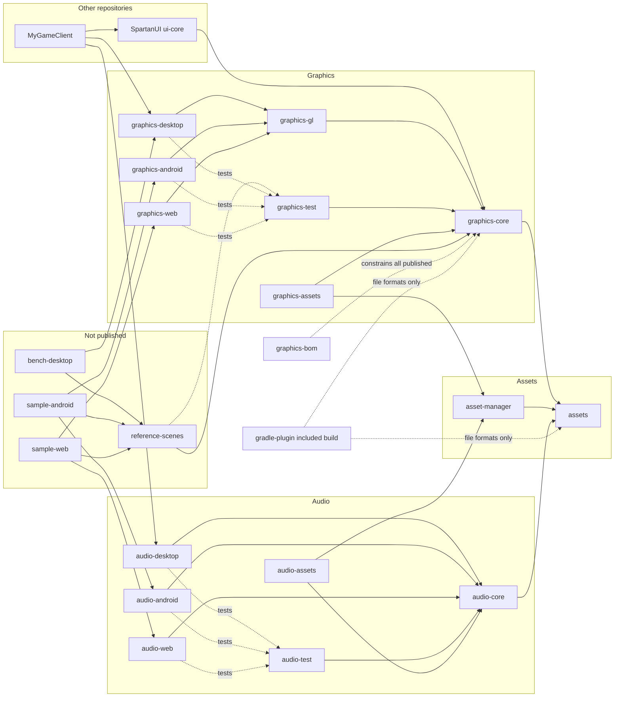
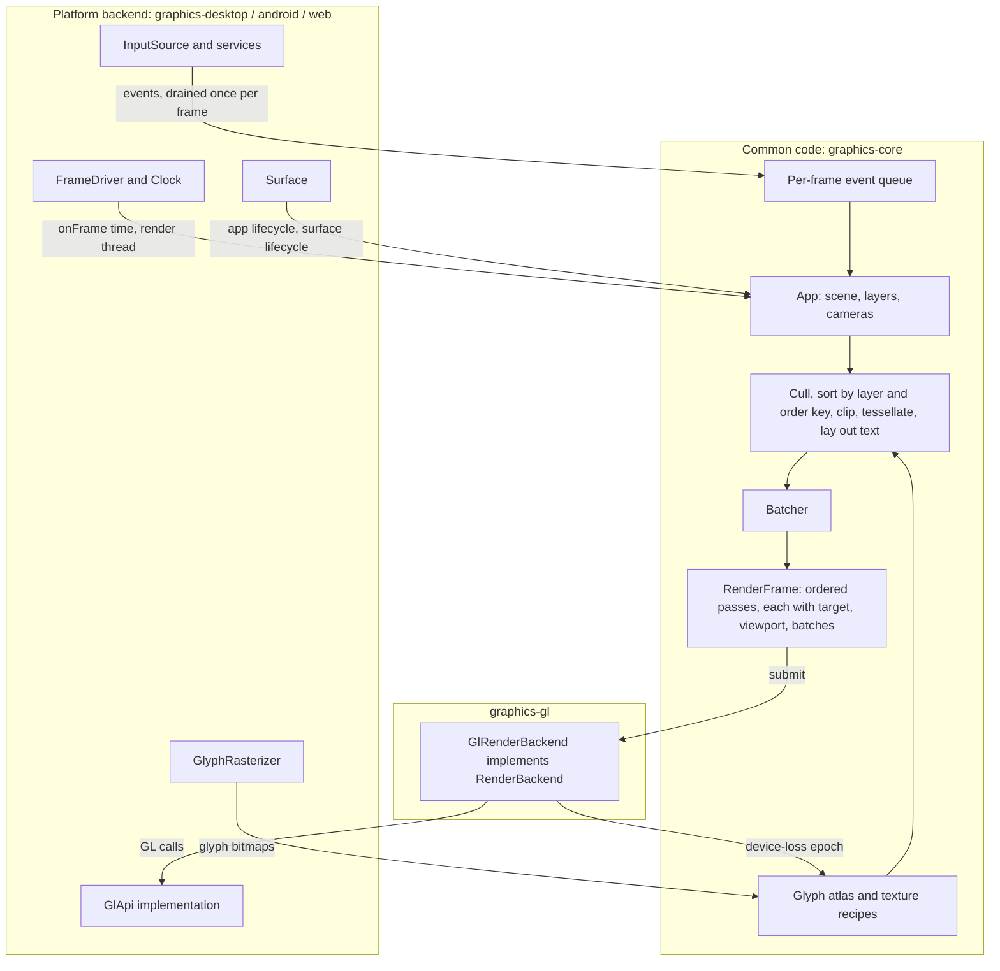

# SpartanGraphics: Target State and Phased Roadmap

## Header / Association

- **Covers:** the target architecture and the phased roadmap for
  [`SpartanLaboratories/SpartanGraphics`](https://github.com/SpartanLaboratories/SpartanGraphics):
  a Kotlin Multiplatform 2D graphics library, with its asset-loading and audio artifacts, that has
  no knowledge of GameTools or of any game. It is published to Maven Central under
  `io.github.spartanlaboratories`, by hand, in packages under `com.spartanlabs`.
- **Origin:** a scoping interview with Spartak Singh on 2026-10-11, on "a roadmap for this repo",
  and his answers to the research findings on 2026-10-19 (section 1).
- **Status:** direction document. The target architecture (section 2) and the phase list
  (section 3) were signed off on 2026-10-19. No source, test or build file exists. Each phase is
  planned in its own issue and plan before implementation. The open decisions in section 5 block
  only the phases that depend on them.
- **Current baseline:** `main` @ `50b61e2` (a README, the Apache-2.0 licence and the split plan).
  Issue [#1](https://github.com/SpartanLaboratories/SpartanGraphics/issues/1), "Phase 1:
  SpartanGraphics (tracking)", is the source of truth for Phase 1.
- **Related documents:**
  - `docs/plans/spartan-libraries-split.md`: the split plan. It is the baseline, and this roadmap
    extends it.
  - `docs/plans/1-phase-1-spartangraphics/architecture.md`: a draft that proposes changes to the
    split plan's module set. None is accepted; each appears below as a marked open item.
  - `docs/roadmap/research/README.md`: the research plan, the verification results, and the
    summary this design rests on. The findings files beside it hold the detail.
  - `MyGameTools/docs/framework-vision-and-roadmap.md`: the sibling roadmap, whose shape and
    tone this one follows.
- **Citations:** documents by section, code by symbol, never by line number.

How to read the open markers: a line that starts "**Open (recommended: ...)**" names a call that
is not settled. The recommendation is shown so the design reads whole; nothing marked open is
built on until it is settled.

---

## 1. Scope decisions

From the interview of 2026-10-11, refined on 2026-10-19 by the answers to the research findings.

| # | Question | Decision |
|---|---|---|
| 1 | Horizon | **The final state, phased all the way,** with 1.0 as a named milestone along the way. |
| 2 | Versioning | **0.x until 1.0.** Breaking changes are batched at phase boundaries into 0.2.0, 0.3.0 and so on; 1.0.0 is the deliberate stability release. One shared version for every artifact in the repository. |
| 3 | When 1.0 ships | **After the web backend.** |
| 4 | What 1.0 freezes | **The app-facing API and the backend contracts.** The contracts graduate to `@SupportedExtension` with a documented example backend. Seams no consumer has proven stay Experimental behind `@RequiresOptIn`. |
| 5 | Platforms | **Windows, Android and web are official.** macOS and Linux "should work, untested", listed under Later. iOS is out of the roadmap. |
| 6 | Order | **Real fonts and text input first, then Android, then web, then 1.0, then the remaining features.** *(Amended 2026-10-19:)* playback control and the audio model (buses, streamed music, crossfade) move ahead of Android, on an OpenAL desktop backend, as an independent audio track in Phase 2. Android and web audio are written once, in Phases 3 and 4. Positional audio stays after 1.0. |
| 7 | Dimension | **2D with room for 3D.** *(Refined 2026-10-19:)* the room is reserved at the renderer and camera boundary. The reservations are listed in 2.4. Shapes, `Point`, `Size` and `Rect` stay strictly 2D. A pre-1.0 spike drives a depth-tested 3D layer through the frozen contracts. The 3D track is beyond this roadmap, and every scheduled phase is 2D. |
| 8 | Performance | **Desktop: 10k textured quads of about 32 px (single atlas, alpha-blended, moving and rotating; about 10 Mpx covered at 1080p) at 60 fps on a mid-range desktop GPU.** *(Unit fixed 2026-10-19.)* Every gate is stated as sprites plus covered area. The Android and web targets are set by research (2.6) and confirmed by the first sample-app measurement. Batched drawing comes early, enforced by a Level 4c performance gate. |
| 9 | Proof | **An unpublished sample app per platform in this repository proves the Android and web backends.** The game client proves the desktop backend. |
| 10 | CI hosts | *(Settled 2026-10-19:)* **Linux runners may host the official platforms' tests**: the Android emulator, headless Chromium, and llvmpipe pixel tests of the shared GL renderer. The Linux desktop backend itself (windowing, input, packaging) stays untested. macOS is compile-only. |
| 11 | Feature scope | **Scheduled** (the codes label the items in section 3):<ul><li>**R1** more shapes (lines, circles, polygons, rounded rectangles, gradients, nine-slice), with SpartanUI's needs first;</li><li>**R2** more outline shapes (rotating with the object, ellipse);</li><li>**R3** sprite atlases and frame animation;</li><li>**R4** tile-map layers;</li><li>**R5** render-to-texture, several cameras or viewports, and a generic visibility mask, with the visibility rules left in the client;</li><li>**R6** particles (late);</li><li>**R7** custom shaders and post-processing (Experimental, last);</li><li>**T1** real fonts;</li><li>**I1** touch and gestures, text input with IME and clipboard, custom cursors;</li><li>**A1** playback control and WAV/OGG;</li><li>**A2** volume buses and streamed music with crossfade;</li><li>**A3** 2D positional audio (late);</li><li>**S1** an asset manager;</li><li>**S2** hot reload and a build-time asset plugin.</li></ul>**Later:** **R8** parallax, skeletal animation and 2D lighting; **T2** CJK, shaping and right-to-left text; **I2** gamepad; **A4** reverb, filters and ducking. **Out:** nothing. |
| 12 | Baseline | **The split plan is the baseline.** Phase 1 is its G1 to G7, summarised from issue #1 and not re-planned. The Phase 1 architecture draft's proposals are open decisions. |
| 13 | Rendering API | **Chosen by research:** the OpenGL family on every platform (2.1). |
| 14 | Audio's home | **This repository,** in artifacts that depend on no graphics module. |
| 15 | Shape set | **Closed.** Custom drawing only through the custom-shader seam. |
| 16 | GeneralTools#7 | **An open decision** (section 5, item N). |
| 17 | Documents | This roadmap and its research live in `docs/roadmap/`; it is not a plan and needs no issue folder. Roadmap Phase 1 is issue #1, and later phases are 2 to N. The split plan's Phases 2 and 3 belong to SpartanUI and the game client. |

---

## 2. Target architecture

### 2.1 Module layout

One repository, one version for every artifact, one Gradle module and one Maven artifact per
module. Module folders are flat at the repository root, and folder name, Gradle project name and
artifactId agree so that a consumer's `includeBuild("../SpartanGraphics")` substitutes them with
no rules.

```
SpartanLaboratories/SpartanGraphics    io.github.spartanlaboratories     packages com.spartanlabs.*

  Published (Maven Central, shared version)
  graphics-bom         BOM   Constraints that keep every artifact below on one version.
  graphics-core        KMP   com.spartanlabs.graphics. The app-facing model and the backend
                             contracts: basic types, Matrix4, cameras, shapes, layers, culling,
                             picking, outlines, input model, text layout and glyph atlas, the
                             batcher, RenderFrame, and every platform SPI.
  graphics-gl          KMP   com.spartanlabs.graphics.gl. The one batched GL renderer, written
                             against a thin GL seam (GlApi). commonMain only: no platform-specific
                             source set; compiled for the library's jvm and js targets.
  graphics-desktop     JVM   com.spartanlabs.graphics.desktop. LWJGL: GLFW window and input,
                             GL 3.3 GlApi, stb_truetype rasteriser, cursors, clipboard, IME.
  graphics-android     AAR   com.spartanlabs.graphics.android. GLSurfaceView, GLES 3.0 GlApi,
                             touch, InputConnection text session, Canvas rasteriser.
  graphics-web         KMP   com.spartanlabs.graphics.web. Canvas, WebGL2 GlApi, Pointer Events,
                             hidden-textarea text session, OffscreenCanvas rasteriser.
                             Targets: js; wasmJs compile-only until published.
  graphics-test        KMP   com.spartanlabs.graphics.test. Recording backend, scripted input,
                             manual clock, fixed surface, and the conformance suites per SPI.
  graphics-assets      KMP   com.spartanlabs.graphics.assets. Texture, atlas and font loaders for
                             the asset manager. (Post-1.0.)

  assets               KMP   com.spartanlabs.assets. AssetSource, name grammar, failure types,
                             memory/prefix/composite sources, per-platform loaders.
  asset-manager        KMP   com.spartanlabs.assets.manager. Async loading with handles, caching,
                             unloading, preload groups. No graphics dependency. (Post-1.0.)

  audio-core           KMP   com.spartanlabs.audio. AudioEngine, Clip, StreamSource, Voice,
                             AudioBus tree, Listener, and all mixing policy. No graphics dependency.
  audio-desktop        JVM   com.spartanlabs.audio.desktop. OpenAL Soft, stb_vorbis, JLayer.
  audio-android        AAR   com.spartanlabs.audio.android. SoundPool, MediaPlayer, audio focus.
  audio-web            KMP   com.spartanlabs.audio.web. Web Audio. Targets as graphics-web.
  audio-test           KMP   com.spartanlabs.audio.test. Fake backend, manual clock, conformance.
  audio-assets         KMP   com.spartanlabs.audio.assets. Clip and stream loaders for the asset
                             manager. (Post-1.0.)

  Not published
  reference-scenes     KMP   com.spartanlabs.samples.scenes. The shared, seeded reference scenes
                             and the capture/benchmark runner with its result schema.
  bench-desktop        JVM   com.spartanlabs.samples.bench. The desktop benchmark harness for the
                             Level 4c gate. A test fixture, not a sample app.
  sample-android       APP   com.spartanlabs.samples.android. Proves graphics-android and
                             audio-android.
  sample-web           KMP   com.spartanlabs.samples.web. Proves graphics-web and audio-web.

  Included builds (not Gradle subprojects of the library build)
  build-logic/         Convention plugins that build the libraries: KMP library, JVM library,
                       Android library, ABI validation, publishing. Private.
  gradle-plugin/       The asset build plugin (manifest, atlas, fonts, compression), consumed
                       through pluginManagement { includeBuild }. (Post-1.0.)
```

External consumers, in other repositories:

```
SpartanLaboratories/SpartanUI          ui-core      api(graphics-core); tests use graphics-test
SpartanLabsGaming/MyGameClient         the GameTools RTS client, JVM 23
                                       graphics-desktop, audio-desktop, ui-core
```

**The device-family rule.** Every library that has platform backends has one module and one
artifact per device family: `-desktop`, `-android`, `-web`. A backend is a choice (OpenGL now,
WebGPU, Vulkan or Metal possibly later), so it is never a source set inside a core module.
Three consequences follow:

- Pure-common modules (`graphics-core`, `graphics-gl`, `audio-core`, the test modules, the asset
  manager and its adapters) have **no Android target**. An Android app resolves their `jvm`
  variant. Their JVM bytecode level is therefore chosen with Android in mind (see the open item
  under 2.5).
- `graphics-android` and `audio-android` are plain `com.android.library` modules. Any KMP module
  that has Android source sets uses `com.android.kotlin.multiplatform.library`. Only the Android
  modules need the Android SDK to build.
- A new backend (WebGPU, Vulkan, Metal, a miniaudio audio backend) is a new module that
  implements the same SPIs. It never replaces a GL backend.

**Where the shared GL renderer lives.** In `graphics-gl`, a pure-common module. `GlRenderBackend`
implements `RenderBackend` for any context that can supply a `GlApi`: a thin seam of about forty
GL entry points in the style of libGDX's `GL20`/`GL30`. Each GL-family backend contributes only a
`GlApi` (LWJGL `GL33` on desktop, `android.opengl.GLES30` on Android, `WebGL2RenderingContext` as
hand-written `external` declarations on web) and a surface. The built-in shaders are authored once
in a GLSL ES 3.00 subset; the `GlApi` supplies the per-platform `#version` header. Pipelines,
texture upload, buffer rings, scissor clipping, device-loss rebuild and frame statistics are
written once.

**Open (recommended: extract at the start of Phase 3).** Issue #1 has no `graphics-gl` module.
Until the second GL backend exists the renderer lives in `graphics-desktop`, in an internal
package that depends on `GlApi` and never on LWJGL; a Level 2 test that runs the renderer against
a recording `GlApi` keeps that seam honest. Phase 3 then moves the package into `graphics-gl`
with no public API change. The alternative is to create `graphics-gl` at G1.

**The asset modules.**

- `assets` holds the `AssetSource` contract and everything audio and graphics both need to read
  bytes by name. The contract is `suspend` and returns `Result`, with a written name grammar.
  Capability interfaces (streaming, locator, listing, change notification) are separate
  interfaces found with an `is` check, so adding one never breaks an implementer of the base.
  The memory, prefix and composite sources live here.
- **Open (recommended: one `assets` module with the loaders in its platform source sets).** Three
  forms are on the table:
  - *`assets`, loaders inside:* the classpath and directory loaders in `jvmMain`, the
    `AssetManager` loader in `androidMain`, the `fetch` loader in the web source set. This keeps
    an audio-only app off the graphics backend and costs no extra artifacts. It applies the device
    family rule to dependency-bearing backends only and treats dependency-free platform glue
    (a few small classes per platform) as source sets. The module needs the Android-KMP plugin.
  - *`assets-core` with the loaders inside the graphics backends* (issue #1 and the split plan):
    an audio-only app needs the graphics backend just to load a file.
  - *`assets-core` plus `assets-desktop`, `assets-android`, `assets-web`:* strictly per family, at
    the cost of three more artifacts to release by hand. This is the fallback if the first form
    is rejected.
- `asset-manager` is its own module, post-1.0, generic over an `AssetLoader<T>` that it owns. It
  depends on `assets` and coroutines and on nothing from graphics or audio. The texture, atlas
  and font loaders live in `graphics-assets`, the clip and stream loaders in `audio-assets`, each
  depending on the manager and on its own core. This keeps `graphics-core` and `audio-core` free
  of the manager, so the manager stays opt-in. Putting the loaders in the manager would give it a
  graphics dependency; putting them in the cores would make every graphics user carry the manager.
- Textures are created from decoded pixels and held as opaque tokens, with a rebuild recipe kept
  by common code. The white fallback texture for a missing asset is a policy of the layer above
  the source, never of `AssetSource`.

**The audio modules.** `audio-core` depends on `assets` and on no graphics module. It owns the
contract and all policy: bus gains, voice limits and stealing, fades, crossfade, ducking rules,
positional gain and pan, and the web unlock rule. A backend receives only per-voice gain, pan,
rate and loop, plus lifecycle. `audio-desktop` is the JLayer port at 0.1.0, then OpenAL Soft
through LWJGL with `stb_vorbis` for Ogg and JLayer retained for MP3. `audio-android` uses
`SoundPool` for clips and `MediaPlayer` for streams, with audio focus. `audio-web` uses Web Audio
with a real `GainNode` per bus. OpenAL Soft and JLayer are LGPL; the README and NOTICE say so.

**The asset build plugin.** `gradle-plugin/` is a separate included build, not part of
`build-logic` (which holds private conventions for building the libraries) and not a library
module (it runs on Gradle's embedded Kotlin and JDK). Its tasks land in the order: `manifest`,
`atlas`, `fonts`, `compress`. Plugin and runtime are coupled by versioned file formats
(`formatVersion` in the manifest and atlas descriptors), never by shared code. The plugin carries
the repository's shared version. **Open (recommended: the Gradle Plugin Portal, plugin id
`io.github.spartanlaboratories.assets`):** the alternative is Maven Central only, at the cost of
consumers adding `mavenCentral()` to `pluginManagement` and of no Portal discoverability.

**The test-fixture and conformance modules.**
**Open (recommended: `graphics-test` and `audio-test`, each holding fakes and the conformance
suites in separate packages).**

- `graphics-test` ships the recording `RenderBackend` (it stores each `RenderFrame` and the frame
  statistics), a scripted `InputSource`, a manual `Clock` and a fixed-size `Surface`. The
  recording `GlApi` that keeps the shared renderer's seam honest is not published: it lives in the
  renderer's own test sources, so `graphics-test` depends on `graphics-core` alone. SpartanUI's
  layout and dispatch tests and the client's tests need exactly these, so
  without the module each repository writes its own. It also holds the published abstract
  conformance suites, one per SPI, which every backend subclasses in its own test source set.
- `audio-test` does the same for audio, which cannot share `graphics-test` because audio has no
  graphics dependency.
- Alternatives: separate `*-conformance` modules (keeps `kotlin-test` out of the fakes'
  consumers, costs two artifacts), or no published fakes (every consumer re-invents them).
- The seeded reference scenes and the capture/benchmark runner are not published: they are
  fixtures for this repository's sample apps and benchmark harness, in `reference-scenes`.

**The sample apps.** `sample-android` and `sample-web` are unpublished and prove their backends:
each runs a reference scene in capture mode (writes a PNG) or benchmark mode (writes a JSON
result), selected by intent extras or a query string. The desktop backend is proven by the game
client; `bench-desktop` exists only to run the Level 4c gate on desktop, because the client is a
ten-zombie demo and cannot.

**Other open items in the module set.**

- **Open (recommended: adopt `graphics-bom`).** Every module takes `api(platform(graphics-bom))`,
  so SpartanUI 0.2 cannot pull `graphics-core` 0.2 beside a client pinned to `graphics-desktop`
  0.1 and fail at runtime with `AbstractMethodError`. A backend factory also declares the contract
  revision it was built for, so a mismatch fails early with a `Result`.
- **Open (recommended: keep the split plan's artifact names, no prefix).** `assets`, `audio-core`
  and `ui-core` are generic words and jar file names omit the group. A `spartan-` prefix would fix
  that, but coordinates cannot change after the first Central release, so this must be settled
  before G7.
- **Open (recommended: final immutable classes for `Color`, `Point`, `Size`, `Rect`, not
  interfaces).** An interface cannot promise immutability, so a renderer could see a consumer's
  mutable point change mid-frame, and interfaces rule out compact representations. They are
  plain `class`es, not `data class`es, with explicit `equals`, `hashCode` and `toString`; the
  game client adapts GeneralTools and GameTools types to them.
- **Open (recommended: adopt).** The backend SPIs carry
  `@SubclassOptInRequired(ExperimentalGraphicsApi::class)` during 0.x, so apps call them freely
  and anyone writing a backend opts in. At 1.0 the guard becomes `@SupportedExtension` (see 2.5).
- **Open (recommended: adopt).** Tests live in `com.spartanlabs.testing.<level>.<production
  package>`, selected by package filter rather than JUnit `@Tag`, because `commonTest` cannot use
  JUnit tags.

### 2.2 Module dependencies

Arrows point from a module to what it depends on. `api` edges are drawn solid. The dashed edges
are tests-only or compile-only.



Dependency direction rules, all enforced by the module graph:

- Nothing in the graphics or audio families depends on GameTools, GeneralTools, WebTools or any
  consumer.
- `audio-*` never depends on `graphics-*`, and `asset-manager` depends on neither.
- A backend depends on its core and (for GL backends) on `graphics-gl`; a core never depends on a
  backend. LWJGL, `android.opengl` and the DOM appear only in their own family's module, and LWJGL
  is an `implementation` dependency of the desktop modules, never `api`. The libraries declare the
  LWJGL Java APIs only; the application adds the natives for its operating system.
- The test modules depend on cores only, so a consumer's tests never pull a backend.

### 2.3 How a frame and an event cross the boundaries

The core owns the logic and emits a description; a backend executes it. The platform owns the
loop.



What crosses each boundary:

| Boundary | Direction | Shape | Contract |
|---|---|---|---|
| Platform to app | events | call on the frame thread | The platform enqueues input; the app drains the queue once per frame, so no input callback runs mid-frame. |
| Platform to app | frames | call | `FrameDriver` calls `onFrame(time)` only while active. A hidden or paused gap is not a frame delta. The app's own fixed-timestep loop (or GameTools') runs inside that call. |
| App to common code | scene | shared state | Shapes and layers are mutated on the render thread only. |
| Common code to backend | frame | one call, `submit(frame)` | The `RenderFrame` is a value. The backend never calls back into common code during `submit`. |
| Backend to common code | device loss | state plus listener | A `deviceEpoch` bump means every backend handle is invalid. Common code rebuilds pipelines from descriptors and re-uploads textures from recipes on the next frame. |
| Common code to backend | glyphs | call | The backend rasterises one glyph; common code owns the atlas, the layout and the batching. |

### 2.4 Cross-cutting principles

- **Mechanism in the library, policy as parameters.** The library ships the core mechanism and a
  default for every rule a consumer might reasonably disagree with. Batch capacity, the frame
  delta cap, glyph-atlas page size and eviction, the line breaker, voice limits and stealing,
  attenuation, ducking, the unlock policy and the format preference are each a parameter, a
  strategy object or a registry, with today's behaviour as the default.
- **Common code owns the logic; backends stay thin.** Shapes, tessellation, culling, layer and
  order sorting, clipping, outlines, text layout, atlases, animation, tile-map chunk caches,
  particles, batching, bus policy and positional maths are common code. A backend implements a
  capability set, a texture store, pipelines from descriptors, `submit`, a device-loss epoch, a
  glyph rasteriser, an input source, and per-voice audio. New drawing features are therefore a
  minor release of `graphics-core` with no backend change, because they are textured,
  vertex-coloured triangles through the one universal pipeline.
- **GPU resources are rebuilt from recipes.** Common code keeps a recipe (asset name or CPU
  pixels, a pipeline descriptor) for every texture and pipeline; the backend holds only opaque
  tokens. Render-target contents are never recoverable; the game redraws them.
- **Three lifecycle channels, three owners.** App lifecycle (paused, resumed, low memory, focus,
  visibility) comes from the surface or frame driver. Surface lifecycle (created, resized,
  destroyed) comes from the surface. GPU device loss comes from the backend's `deviceEpoch`. Pause
  does not imply device loss. The contract states what each backend must raise and the
  conformance suites assert that every declared event can fire.
- **Additive evolution.** The contracts are designed for it from the first release, and it is
  mandatory from 1.0. During 0.x a breaking change is still allowed, but only in a phase-boundary
  release.
  - Every new member of a contract has a default body, never a new abstract member. On the JVM
    the bodies compile to real default methods (`-jvm-default=enable`); on klib targets the
    old-implementor relink fixture checks that they are inherited.
  - New operations are optional sub-interfaces found by typed lookup; new behaviours are
    capability keys. Capability keys are an open class, not an enum.
  - Frozen descriptors are final classes with builders, never `data class` and never long
    parameter lists, so a new field is a new builder property with a default.
  - Command, event and failure hierarchies are open, with a documented "unknown means skip and
    report" rule.
  - Frozen signatures contain no value classes, `inline`, `reified` or context parameters.
  - `languageVersion` and `apiVersion` are pinned to the oldest Kotlin consumers are expected to
    use.
- **Open hierarchies for extension; a closed shape set by design.** Systems and infrastructure
  (backends, sources, strategies, rasterisers, line breakers, attenuation models) are interfaces
  with a supplied default implementation. Events, failures and capability keys are open. The
  drawable shape set is the one deliberate exception: `Shape` has an internal constructor, so
  apps compose from the shipped shapes and cannot add their own. The set can grow only in this
  library, and custom drawing arrives only through the Experimental custom-shader seam. Where a
  member keeps an invariant, it is `final` or `internal`.
- **The render-thread rule.** Every backend call and every scene mutation happens on the render
  thread (the GL thread on Android, the single JS thread on the web, the first thread on macOS).
  Audio callbacks never run user code on the audio thread: events are queued and dispatched on
  the game thread. The asset manager's commit stage is the only stage that may touch GPU or audio
  device state, and it runs on the context owner's thread.
- **`Result` for expected failures.** A missing asset, an unsupported format, a shader that does
  not compile and a refused capability are values, drawn from small open exception hierarchies.
  Programmer errors (drawing after close) stay exceptions. `CancellationException` is always
  rethrown. GPU handles are `AutoCloseable` with an idempotent `close()` that is safe after
  context loss.
- **2D with room for 3D, reserved at the renderer and camera boundary.** `Point`, `Size`, `Rect`
  and every shape are strictly 2D and carry no depth. The reservations are: a column-major 4x4
  `Matrix4`; a per-layer view-projection; a thin `Camera` interface above a concrete `Camera2D`;
  frames as ordered layers, each with its own camera, clip and viewport; an integer order key
  with a stable insertion tiebreak instead of z; depth and stencil request fields, default off;
  pipeline descriptors that name their vertex layout (the universal 2D layout stays `xy`, and a
  3D family declares its own `xyz` layout); and a `PickHit` pick result. A 3D track is a separate
  renderable family in its own module behind an opt-in capability.
- **No allocation in the hot path.** Functional, immutable types sit around the renderer;
  imperative buffer writes sit inside it. Draw entry points taking a basic type also take scalar
  overloads, and the renderer writes interleaved floats into a reusable buffer. Steady-state
  allocation per frame is a gated number (2.5).
- **One version, phase-boundary breaks, explicit tiers.** Every artifact shares one version. In
  0.x, breaking changes are batched at phase boundaries into 0.2.0, 0.3.0 and so on. Every public
  surface is Stable Core, `@SupportedExtension`, or Experimental behind `@RequiresOptIn`.
  **Open (recommended: allowed):** additive work that is ready before its phase's boundary release
  ships early as an additive release that raises the last digit (0.1.1 after 0.1.0, for example),
  while every breaking change waits for the boundary release. The alternative is that nothing
  ships between boundaries.

### 2.5 The 1.0 contract map

1.0 freezes the app-facing API and the backend contracts. The backend contracts graduate from
`@SubclassOptInRequired(ExperimentalGraphicsApi)` to `@SupportedExtension`, which carries the same
semver guarantee as Stable Core. The opt-in guard stays only on surfaces that no consumer has
proven.

**Stable Core (app-facing):**

| Surface | Contents |
|---|---|
| Basic types | `Color`, `Point`, `Size`, `Rect`, `Matrix4` |
| Cameras | `Camera`, `Camera2D` (world/screen conversion, zoom, pan, centre on, visible region) |
| Draw model | the closed shape set, world and screen layers, ordered layers with camera, clip and viewport, the integer order key, nested intersecting clips, outlines with the default style, culling, the texture source rectangle |
| Picking | picking against a layer, returning `PickHit` |
| Input model | Pointer-Events-shaped pointer events (id, kind, phase including cancel, primary flag, pressure, modifiers), physical keys named by `KeyboardEvent.code` strings with a repeat flag, scroll, the per-frame queue, an `InputTracker` that synthesises releases on focus loss |
| Text | `Font`, `TextStyle`, `TextLayout`, `TextMeasurer`; the line box is separate from the ink bounds |
| Assets | the name grammar, the `AssetException` base types, the texture rebuild recipe rules (the `AssetSource` interface itself is a backend contract, in the next table) |
| Audio | `AudioEngine`, `Clip`, `StreamSource`, the generation-checked `Voice`, the `AudioBus` tree, `Listener`, the policy parameter types |
| Entry | the frame-driver entry point and the game-loop contract |

**`@SupportedExtension` (the backend contracts, with a documented example backend):**

| Surface | Contents |
|---|---|
| `Surface` | pixel size, density, window size separate from framebuffer size, lifecycle events, and a config with depth, stencil and MSAA requests |
| `FrameDriver` and `Clock` | monotonic clock; the paused-gap rule |
| `RenderBackend` | capabilities, `TextureStore`, pipeline creation from descriptors, `submit`, `deviceEpoch`, typed extension lookup |
| `RenderFrame` | ordered passes (target, viewport, clear) of batches (pipeline, texture binding, index range in a named vertex buffer, clip rectangle, blend state); several vertex layouts per frame; 16- and 32-bit indices; blend presets and separable factors; a per-vertex texture-slot field; sampler state; sub-region texture update; a per-layer device-pixel scale; an open `PassTarget` with only the surface implemented |
| `InputSource` | pointer, keys, scroll, and its services: text-input session, async clipboard, cursor |
| `GlyphRasterizer` | rasterise one glyph at a size |
| `AssetSource` and the streaming and locator capabilities | the base graduates with the in-memory source and one platform source as worked examples; streaming and locator graduate because the three audio backends use them |
| `AudioBackend` | capability set, decoders probe, clip and stream creation, bus creation, voice start, per-voice gain/pan/rate/loop, lifecycle, an event queue |

**Experimental at 1.0 (`@RequiresOptIn`, may change in a minor):**

| Surface | Why it stays Experimental |
|---|---|
| Render-target creation, the `Load` pass operation, the `contentsLost` signal | first consumer is R5 (Phase 10) |
| Retained geometry | built only if a measured tile scene fails the gate |
| Pixel readback | used by tests only |
| MSAA request | only if the gate demands it |
| Stencil state in pipeline descriptors | first consumer would be a rounded-corner clip |
| Every pipeline kind besides the universal one, and custom shaders | the custom-shader phase (Phase 14) |
| `TextShaper` | HarfBuzz follows with complex scripts |
| Gesture recogniser | graduates when a consumer (SpartanUI touch scrolling) builds against it |
| `ListingAssetSource`, `ChangeNotifying`, hot reload | desktop-only tooling |
| Audio bus effects | no consumer; reserved |
| `GlApi` and `GlRenderBackend` | see below |

`GlApi` and `GlRenderBackend` are public because three modules in this repository implement and
use them, but they are not the backend contract: a third-party backend implements `RenderBackend`.
They stay Experimental and graduate only if a consumer outside this repository builds against
them, because freezing about forty GL entry points would constrain a later non-GL backend for no
present benefit.

**Reserved slots for later features.** Each is a place in a frozen contract that a later phase
fills without adding an abstract member:

| Slot | Where it is reserved | Tier | Filled by |
|---|---|---|---|
| 3D seams (`Matrix4`, view-projection, `Camera`, order key, depth/stencil request, vertex-layout-naming descriptors, `PickHit`) | renderer and camera boundary | Stable Core | the unscheduled 3D track; validated by the pre-1.0 spike |
| Render targets | open `PassTarget`; optional `RenderTargets` sub-interface | Experimental | Phase 10 |
| Retained geometry | optional sub-interface found by typed lookup | Experimental | tile-map tier 2, on measured need |
| MSAA | surface-config request field | Experimental | only if the gate demands it |
| Stencil state | pipeline descriptor field | Experimental | a rounded-corner clip, if SpartanUI wants one |
| Custom pipelines and shaders | descriptor kinds and a shader-program concept | Experimental | Phase 14 |

Not reserved: transform feedback, compute, and GPU particles. GLES 3.0 and WebGL2 have no
compute, which caps only the unscheduled 3D track.

**The documented example backend.** **Open (recommended: as below).** The alternative for
graphics is `graphics-web`, a real GPU backend, as the example of record.

- **Graphics: the recording backend in `graphics-test`.** It implements every SPI in a few hundred
  lines of dependency-free common code, runs on every target in CI, passes the conformance suites
  it ships, and is the backend SpartanUI and the client already test against. A reader sees what
  each member must do without GPU noise. For a real GPU, the `graphics-web` sources are the
  annotated companion reading.
- **Audio: `audio-web`.** Web Audio maps almost one-to-one onto the contract (a node per bus, a
  gain and a panner per voice), so it is the readable real implementation.

**Binary and source compatibility.** JVM and Android artifacts are binary compatible within a
major. JS (and Wasm, once published) are source compatible within a major, with additive-only
evolution, because the Kotlin toolchain has not finalised klib binary compatibility. The promise
is enforced, not asserted: klib and JVM ABI dumps are checked on every build, from G1 if issue #1
adopts the ABI-validation proposal and otherwise from Phase 2, and an old-implementor fixture
compiles a backend against the frozen contract and runs it against every later build.
**Open:** the exact wording of the promise to consumers.

**Platform floors (open).** minSdk 24 is recommended (about 96.6% of devices; the AndroidX
default; `PointerIcon` arrives in API 24). Libraries set no targetSdk, and compileSdk is the
newest the pinned AGP supports. Android-consumed `jvm` variants compile with `-Xjdk-release` so a
JDK 21 build cannot leak JDK 21 APIs. **Open:** whether Android tooling accepts the libraries'
JVM 21 bytecode; the Android sample app's release build is the gate, and the fallback is to lower
only the Android-consumed modules to 17. **Open:** that plain `com.android.library` stays
supported under AGP 10 is inference; Phase 3 confirms it, and the fallback is a single-target KMP
module on the Android-KMP plugin.

### 2.6 Verification architecture

No CI runner has a GPU. The renderer is verified on software rasterisers, and timing is verified
on named reference hardware.

| Level | Technique | Where it runs |
|---|---|---|
| 1 | local gating on changed code | developer machine |
| 2 | the batcher, draw-list translation and the recording backend; the shared renderer against a recording `GlApi`; audio policy against the fake audio backend | any runner |
| 3 | the conformance suites per SPI, run by each backend; real GL on llvmpipe (shader compile and link, framebuffer-readback pixel probes of clip, blend, order and texture formats) | Linux runner under Xvfb; Android emulator; headless Chromium |
| 4a | scene to draw-call-count and vertex-bytes mapping; pure functions (tessellation, layout, culling, camera maths) | any runner |
| 4b | sample apps render N frames of the seeded reference scene and compare a PNG with a tolerant golden | Xvfb; headless Chromium on SwiftShader; Android emulator, nightly |
| 4c | structural counters in CI; timing on reference hardware | CI and the release gate |
| 5 | the game client, reference-device runs, human review | by hand |

- **The recording backend** (`graphics-test`) stores each `RenderFrame` and the frame statistics.
  It tests everything above the renderer: batching, flush reasons, clip splitting, layer order,
  text layout, and the 4c structural counters, all with exact assertions and no GPU.
- **Conformance suites, one per SPI.** Each is an abstract test class published from
  `graphics-test` or `audio-test`, covering the surface and lifecycle events, `RenderBackend`
  (texture round-trip, pipeline creation, the device-loss rebuild, capability honesty), the input
  source and its services, the glyph rasteriser, and the audio backend. Each backend subclasses
  them. A render-target suite arrives with Phase 10, the one post-1.0 phase that adds backend
  obligations.
- **Software rasterisers on Linux runners.** The Linux runners host the official platforms'
  tests: llvmpipe under Xvfb exercises the shared GL renderer through the desktop `GlApi`, headless
  Chromium on SwiftShader exercises `graphics-web` (the test asserts the renderer string, since
  WebGL can degrade silently), and a hardware-accelerated Android emulator exercises
  `graphics-android`. The Linux desktop backend itself (windowing, input, packaging) stays
  untested. Goldens are generated on the CI rasteriser and compared per channel with a maximum
  differing-pixel fraction; analytic pixel probes are preferred to many goldens, and content is
  pixel-aligned and nearest-filtered so output is near-exact across rasterisers.
- **CI jobs.** `windows-latest` runs the full build and the non-GL tests (GL-opening tests are
  tagged out, because a crashing window can kill the test host). `ubuntu-latest` compiles the
  desktop backend, runs the Xvfb and Chromium tests, and runs the emulator nightly.
  `macos-latest` compiles the desktop backend only.
- **Sample apps as harnesses.** `reference-scenes` defines one seeded scene set (a sprite swarm, a
  clip-heavy UI, a text-heavy screen) stepped on a fixed timestep independent of render time. The
  Android and web sample apps and `bench-desktop` run it in capture or benchmark mode and write a
  PNG or a JSON result.
- **The Level 4c gate has two halves.**
  - *Structural counters, on every commit, any runner:* on the recording backend, a draw-call
    ceiling, flushes by reason, bytes uploaded, and steady-state allocation of about zero per
    frame.
  - *Timing, at release, on named reference hardware:* warm up (discard the first frames for
    shader compile, JIT and ART profile), then measure a fixed frame count of the seeded scene and
    record p50, p95, p99 and max for CPU and wall frame time; on desktop add GPU time; add an
    uncapped pass for headroom. The JSON result is committed per release and a regression fails
    the gate. Android wall timing uses SurfaceFlinger's `--timestats`; browser GPU timers are not
    used.
  - *Targets*, every one stated as sprites plus covered area:

    | Platform | Target |
    |---|---|
    | Desktop | 10k textured quads of about 32 px (single atlas, alpha-blended, moving and rotating; about 10 Mpx covered at 1080p) at 60 fps on a mid-range desktop GPU |
    | Android | 5k sprites as the hard gate, 10k as the target, on a Mali-G57/G68 or Adreno 619-class phone at 1080p; promoted once the first measurement shows at least 30% headroom. Floor: Mali-G52 at 720p, report-only |
    | Web | 10k sprites on an Iris Xe-class laptop in Chrome stable; Firefox and Safari report-only |

    The Android and web figures are set from thin evidence and are confirmed by the first
    sample-app measurement.
  - **Open:** the named reference hardware (a desktop card, a phone, a laptop).
  - **Open (recommended: Phase 2, first item):** where the gate first lands. See Phase 2.

### 2.7 How it attaches to adjacent repositories

| Repository | How they meet |
|---|---|
| **SpartanUI** (`ui-core`) | `api(graphics-core)` through a composite build in development and Maven Central in release. SpartanUI builds elements on shapes, clip, picking, the input model and text measurement, and tests against `graphics-test`. It never depends on a backend. Because of the `api` edge, **every breaking graphics 0.x boundary pairs with a SpartanUI minor**. Text-field input, when SpartanUI wants it, uses the text-input session. SpartanUI's touch scrolling uses the Android phase's touch events and gesture recogniser. |
| **MyGameClient** | Depends on `graphics-desktop`, `audio-desktop` and SpartanUI's `ui-core`, composite-built in development. It owns every adapter from GameTools and GeneralTools types to library types, its asset directories and names, the tile palette-to-region mapping, the visibility mask, and the position of every sound. It proves the desktop backend and the 0.1.0 audio port. It cannot prove the 4c gate. |
| **GameTools** | Neither side depends on the other. Every graphics phase is independent of GameTools. The client features gated on GameTools (tiled terrain, fog and minimap, event-driven positional sound, ability and item UI) are post-1.0, and the library's data-shape assumptions are: map visuals are supplied by the client, the visibility mask is built by the consumer, and event positions come from the client. |
| **GeneralTools** | No dependency. The libraries own `Color`, `Point`, `Size` and `Rect`. Under the recommendation that follows, the client's adapters are permanent. **Open (recommended: the libraries never take GeneralTools types):** GeneralTools#7 (multiplatform) would help at most the GeneralTools half of the client's adapters, because GameTools remains JVM-only. |
| **WebTools** | No dependency. WebTools is UDP only and browsers have no raw UDP socket, so a real browser client needs a browser-capable transport in WebTools and a multiplatform GameTools protocol. Neither is scheduled, and no phase depends on them: the web backend is proven by its sample app alone. |
| **The split plan** (`docs/plans/spartan-libraries-split.md`) | The baseline this roadmap extends. Corrected on 2026-10-19 for two points: U5 (scrolling) depends on U3 and G4, not on U2 alone; and its CI and GPU statements now say no runner has a GPU, so the renderer is verified on software rasterisers and timed on reference hardware. A third correction the same day followed #1's adoption of decision A: its shape-level `Renderer` became the frame-level `RenderBackend`. One more waits for its decision: its line that the client's adapters go away when GeneralTools#7 lands (item N). SpartanUI's copy of the plan is corrected when SpartanUI's work starts. |

---

## 3. Phased roadmap

Each phase is independently shippable and maps to one release (or a short release sequence).
Breaking changes are batched at phase boundaries: Phases 2 to 5 ship as 0.2.0 to 0.5.0 and carry
the breaking changes (the 0.5.0 step before 1.0.0 is open; see Phase 5). 1.0.0 is the deliberate
stability release, and every later phase is an additive 1.x minor. Each breaking 0.x boundary
pairs with a SpartanUI minor. Every scheduled phase is 2D.

**Note on the split plan's other phases.** The split plan's Phase 2 (SpartanUI, stages U1 to U6)
and Phase 3 (the game client, stages C1 to C5) belong to `SpartanLaboratories/SpartanUI` and
`SpartanLabsGaming/MyGameClient`. This roadmap numbers the graphics repository's own phases, and
"Phase 1" below is the split plan's Phase 1.

### Phase 1: SpartanGraphics 0.1.0

Summarised from issue #1; not re-planned here. Serves SpartanUI's stages U1 to U6 and the game
client's stages C1 to C4. Upstream prerequisites: none.

1. **G1: skeleton.** Gradle wrapper, version catalog, `build-logic`, empty `graphics-core` (KMP:
   `jvm()` plus `js()` as the non-JVM compile check) and `graphics-desktop` (JVM), CI,
   publishing config, coding rules.
2. **G2: basic types and the camera.** Basic types, a 4x4 matrix type, and `Camera2D`
   (world/screen conversion, zoom, pan, centre on, visible region) behind a thin `Camera`
   interface.
3. **G3: shapes and layers.** Shapes (a textured rectangle with a texture source rectangle;
   `Text` taking a `TextStyle` and an opaque `Font`); world and screen layers as an ordered list
   of layers, each with its own camera, clip and viewport and ordered within by an integer order
   key; culling; picking returning `PickHit`; opt-in outlines with the default style; and a
   screen-space clip rectangle whose nested clips intersect. The draw model emits a `RenderFrame`
   of batches.
4. **G4: abstract input and the platform contracts.** Input shaped like W3C Pointer Events, with
   physical keys named by `KeyboardEvent.code`; a surface with density and depth and stencil
   request fields; a frame-level `RenderBackend` (textures from decoded pixels, pipelines from
   descriptors that name their vertex layout, `submit` of a `RenderFrame` carrying each layer's
   view-projection, capabilities, device loss); text measurement taking a `TextStyle` and
   returning a layout; frames and clock; input source; a new `assets-core` module with a
   `suspend`, `Result`-returning `AssetSource` and its name grammar.
5. **G5: `graphics-desktop`.** GLFW window, one batched GL 3.3 renderer implementing
   `RenderBackend`, with scissor clipping and one view-projection uniform per layer; textures,
   bitmap-font text, classpath assets, frame loop, GLFW input, macOS/Linux handling.
6. **G6: audio.** `audio-core` and `audio-desktop`, loading through `assets-core`, with `play`
   returning a generation-checked `Voice` handle.
7. **G7: release.** `0.1.0` to Maven Central, by hand.

*Ships as 0.1.0. The baseline release; nothing precedes it to break.*

> **Changes to Phase 1.** The shapes below belong in the Phase 1 stages. Issue #1 adopted the
> first ten on 2026-10-19, in its scope-change comment of that date (decision A), and the stage
> list above now carries them. The last three are still open (section 5, decisions B to J). If #1
> adopts one, it lands in the stage named here. If not, it moves to Phase 2, and any of them that
> changes published API joins the 0.2.0 batch of breaking changes.
>
> | Shape | Stage | Status |
> |---|---|---|
> | The 3D seams: `Matrix4`, `Camera` over `Camera2D`, per-layer view-projection, frames as ordered layers with camera, clip and viewport, the integer order key, depth and stencil request fields, vertex-layout-naming pipeline descriptors, `PickHit` | G2 to G5 | Adopted 2026-10-19 |
> | The frame-level `RenderBackend` and `RenderFrame` in place of the split plan's shape-level `Renderer` (the batch state carries the G3 clip) | G3, G4, G5 | Adopted 2026-10-19 |
> | Nested, intersecting clips | G3 | Adopted 2026-10-19 |
> | A texture source rectangle on the textured rectangle | G3 | Adopted 2026-10-19 |
> | Pointer-Events-shaped input with `code`-named keys | G4 | Adopted 2026-10-19 |
> | The `TextStyle`, opaque `Font` and `TextMeasurer` shape (a layout result that separates line box from ink bounds) | G3, G4 | Adopted 2026-10-19 |
> | A `suspend` `AssetSource` returning `Result`, with the name grammar | G4 | Adopted 2026-10-19 |
> | Density on `Surface` | G4 | Adopted 2026-10-19 |
> | A generation-checked `Voice` handle (at least `stop`) in the audio contract | G6 | Adopted 2026-10-19 |
> | G1's non-JVM compile-check target: `js` (the split plan leaves the choice to G1) | G1 | Adopted 2026-10-19 |
> | The module proposals marked open in 2.1: `assets` for `assets-core`, `graphics-test`, `graphics-bom`, guarded SPIs, test packages by level, artifact prefix, basic types as final classes | G1 to G4 | Open: decisions B to H |
> | Whether `graphics-gl` is created in Phase 1 (2.1) | G1, G5 | Open: decision I |
> | Where the Level 4c gate first lands (Phase 2, item 1, or G5) | G5 | Open: decision J |

### Phase 2: Real fonts, text input and the audio engine (0.2.0)

Two independent tracks that share only the `assets` capabilities, and either may finish first.
Every breaking change in either track waits for the boundary release, 0.2.0. Additive work that
is ready earlier may ship as an additive 0.1.x release under the open release rule in 2.4.
Upstream prerequisites: none. Pairs with SpartanUI 0.2.

**Graphics track**

1. **The Level 4c gate.** The structural counters on the recording backend; `reference-scenes` and
   `bench-desktop`; the first named reference hardware; the committed JSON result. This is the
   first item so that fonts, glyph atlases and every later feature are measured against the gate
   from their first commit. **Open (recommended: here):** the gate's natural home is with G5's
   batched renderer, which would make it part of #1. It is placed here because #1 has already
   taken three scope changes, because the frame statistics the structural counters read are not
   among #1's contracts, and because the reference hardware is not yet named. The cost is that
   0.1.0's renderer ships without the gate.
2. **The 0.2.0 batch of breaking changes.** #1 adopted the ten contract shapes on 2026-10-19, so
   this item holds only the module proposals still open in section 5 (decisions B to H) that #1
   does not adopt and that change published API. If #1 adopts them all, this item is empty.
3. **Real fonts (T1).** `Font`, `TextStyle`, `TextLayout`, `TextMeasurer`; a font-table reader; a
   left-to-right shaper with kerning; greedy wrapping with a replaceable line breaker; sizes; a
   runtime glyph atlas with LRU pages in common code; the `GlyphRasterizer` SPI with an
   stb_truetype desktop implementation; opt-in SDF glyphs for world-layer text that zooms. The
   bitmap font stays as the zero-configuration default `Font`. The `DecodedImage` pixel contract
   and a `DirectoryAssetSource` for desktop development land in `assets`. `TextShaper` is
   Experimental.
4. **Text input, clipboard and cursors on desktop (part of I1).** The text-input session
   (state-mirroring, Experimental) through LWJGL's experimental GLFW IME support with a char-only
   fallback; an asynchronous, `Result`-returning clipboard; a cursor service (standard and custom
   image cursors). No consumer exists today: SpartanUI plans no text field, and the session is
   scheduled now so that the Android soft keyboard and the web hidden text area shape the contract
   before it freezes.

**Audio track**

5. **Playback control (A1).** The `AudioEngine`, `Clip` and generation-checked `Voice` contract:
   loop, stop, pause, volume, pan, rate, concurrent sounds, with `play` a non-blocking enqueue and
   stale handles a no-op. WAV and OGG join MP3. Loop sources should be OGG or WAV, since MP3
   encoder padding makes seamless loops impossible.
6. **The audio model (A2).** The `AudioBus` tree (layouts such as `ui`, `combat`, `ambient`,
   `music` under a master), streamed music through `StreamSource`, fades and crossfade, voice
   limits and stealing, ducking rules. Policy lives in `audio-core`. Streaming and locator
   capabilities are added to `assets`. `Listener` is reserved here and used in Phase 13.
7. **The OpenAL desktop backend.** `audio-desktop` moves from the JLayer port to OpenAL Soft with
   `stb_vorbis`, keeping JLayer for MP3; `audio-test` ships the fake backend and the audio
   conformance suite. The LGPL notices land in the README and NOTICE, and the exact licence
   versions of JLayer and OpenAL Soft are checked before publication.

Serves the game client's four sound categories (ui, combat, ambient, atmosphere) and readable text
for both consumers.

*Ships as 0.2.0. #1 adopted the ten contract shapes on 2026-10-19, including the text shape and
the `Voice` handle, so real fonts and the audio engine build on contracts 0.1.0 already has. The
only breaking changes left for this boundary are those in item 2. Everything else in the phase is
additive.*

### Phase 3: Android (0.3.0)

Upstream prerequisites: Phase 2 (the text and audio contracts that Android proves). No consumer
exists beyond the sample app.

1. **Extract `graphics-gl`.** Move the renderer out of `graphics-desktop` into the pure-common
   `graphics-gl`, with no public API change (if it was not created in Phase 1).
2. **`graphics-android`.** A `GLSurfaceView` surface with the full lifecycle (the EGL context is
   lost and recreated, so the device-loss path is exercised for real); the GLES 3.0 `GlApi`;
   density on the surface; touch delivered as a primary pointer through the Pointer Events model
   (touch never fires hover); key events; the clipboard; `PointerIcon` cursors (API 24); a
   `Paint`/`Canvas` glyph rasteriser (font bytes load from API 29, and through a temporary file on
   API 24 to 28).
3. **Text input proven (part of I1).** An `InputConnection`-backed text-input session proves the
   session contract beyond desktop.
4. **Touch and gestures (part of I1).** A pure-common gesture recogniser (tap, drag, fling, pinch),
   Experimental; it is what SpartanUI's touch scrolling will use.
5. **`assets` on Android.** The Android-KMP plugin enters `assets`, with an `AssetManager`-backed
   source. Play Asset Delivery is not covered; the locator capability keeps the door open.
6. **`audio-android`.** `SoundPool` for clips, `MediaPlayer` for streams, audio focus and
   lifecycle pause, written once against the contract Phase 2 settled.
7. **`sample-android` and its gates.** The reference scene in capture mode on the emulator
   (nightly), the first Android measurement that ratifies the 5k and 10k targets, a real
   context-loss run that proves the texture rebuild recipe, and the release build that decides the
   bytecode-level question.
8. **Build confirmation.** AGP 9 with plain `com.android.library` and the Android-KMP plugin;
   minSdk and the bytecode level settled (2.5).

*Ships as 0.3.0, with breaking changes: the contract amendments a second platform forces
(lifecycle events, surface config, anything desktop-shaped found by the Android implementation).*

### Phase 4: Web (0.4.0)

Upstream prerequisites: Phase 3. No consumer exists beyond the sample app.

1. **`graphics-web`.** A canvas surface; the WebGL2 `GlApi` as about forty hand-written
   `internal external` declarations; `webglcontextlost` and `webglcontextrestored` handling that
   rebuilds every resource; a `requestAnimationFrame` frame driver with the hidden-tab gap rule;
   Pointer Events and `KeyboardEvent.code`; CSS cursors; the async clipboard (secure context and
   user activation required); an `OffscreenCanvas` glyph rasteriser; vertex upload behind one
   `expect`/`actual` seam, using `bufferSubData` into a pre-sized buffer (web does not orphan
   buffers). Touch arrives through Pointer Events.
2. **Text input proven (part of I1).** A hidden-text-area session completes the proof on the third
   platform; with desktop and Android it is the evidence the session contract freezes against.
3. **`assets` on the web.** A `fetch`-based source with a configurable base URL, and image decoding
   through `createImageBitmap` with pinned premultiplication and colour-space options.
4. **`audio-web`.** A Web Audio graph with a real `GainNode` per bus and a panner per voice; the
   autoplay unlock state and deferred-start voices in the contract; Ogg depends on Safari 18.4 or
   later.
5. **`wasmJs` tripwire.** The common modules and the web modules gain a compile-only `wasmJs`
   target (no tests, no sample, publication off), so JS-only assumptions in `webMain` are found
   before 1.0 freezes them.
6. **`sample-web` and its gates.** The reference scene under headless Chromium on SwiftShader (per
   commit), the web 4c measurement on the reference laptop, and the context-restored rebuild.

*Ships as 0.4.0, with breaking changes: the amendments the third backend forces.*

### Phase 5: 1.0 stabilisation (0.5.0, then 1.0.0)

1.0 is its own phase. Every earlier phase adds capability; this one adds no feature and has a
single exit test. It is separate from the web phase for four reasons: the freeze needs all three
backends, all conformance suites and every gate finished before it can be reviewed; the pre-1.0 3D
spike and the review of three real backends can find a defect whose only fix is a breaking change,
so one last breaking batch must exist before the freeze; mixing freeze risk with web feature risk
leaves the freeze no room; and SpartanUI needs a release to pair with before the API stops moving.

1. **API review.** Every public symbol is sorted into Stable Core, `@SupportedExtension` or
   Experimental; leftovers and duplicate paths are removed; `explicitApi` and Level 2 KDoc are
   audited; deprecated 0.x members are deleted.
2. **The 3D spike.** A throwaway, unpublished depth-tested 3D layer is driven through the frozen
   contracts, once on the recording backend and once on the desktop GL backend, to find any
   wrong reservation (matrix conventions, order key versus depth, vertex layout naming, pick
   result). Findings are fixed in 0.5.0; the spike is then deleted.
3. **Conformance and the example backend.** Every SPI has a published suite that all backends
   pass; the documented example backends are written up (recommended: the recording backend and
   `audio-web`; open, see 2.5).
4. **Compatibility machinery.** JVM and klib ABI dumps committed as baselines; the old-implementor
   relink fixture (a backend compiled against 0.5.0, run against every later build on JVM, Android
   and JS); `languageVersion` and `apiVersion` pinned; the wording of the compatibility promise
   settled and published.
5. **Gates.** The 4c gate passes on desktop, Android and web reference hardware.
6. **Tier promotion.** `@SubclassOptInRequired` becomes `@SupportedExtension` on the graduated
   contracts; `@RequiresOptIn` stays on the Experimental table in 2.5; the CHANGELOG records every
   graduation.
7. **Documentation and legal.** Migration notes from 0.x, the example-backend guide, the README
   and NOTICE (including the LGPL components), and the licence-version check.
8. **Release.** 0.5.0 (the last breaking batch, paired with a SpartanUI minor), then 1.0.0.
   **Open (recommended: 0.5.0 then 1.0.0):** the alternatives are release candidates
   (`1.0.0-rc.N`) after 0.4.0, or going straight from 0.4.0 to 1.0.0 with the review findings
   inside it.

*Ships as 0.5.0 (the final breaking batch), then 1.0.0, which has the same API as 0.5.0 with the
tiers promoted and the ABI baselines committed. 1.0.0 carries no breaking change from 0.5.0.*

### After 1.0: additive 1.x phases

Every phase below is additive: it leaves a consumer that ignores it behaving exactly as before,
and it changes no frozen contract. The landing order follows SpartanUI's needs first, then the
asset foundations the later features depend on, then features by cost, with particles and
positional audio late and custom shaders last. Phases 12 and 13 are independent and may land in
either order.

#### Phase 6: SpartanUI shapes (1.1.0)

Serves SpartanUI. Upstream prerequisites: none.

1. **Nine-slice (R1).** Nine quads on a shared vertex grid, using the texture source rectangle.
2. **Linear gradients (R1).** Vertex colours, exact.
3. **The tessellator and the stroker (R1).** CPU tessellation at the layer's device-pixel scale,
   with a feathered antialiasing fringe in vertex alpha, drawn through the universal pipeline and
   sampling a white texel so shapes batch with sprites. Rounded-rectangle fill and outline are its
   first customer (the SpartanUI focus ring on a rounded control).

*Ships as 1.1.0. Additive; no backend change.*

#### Phase 7: More shapes and outlines (1.2.0)

Upstream prerequisites: Phase 6.

1. **Lines, circles and polygons (R1).** Lines and circles from the stroker and tessellator;
   simple concave polygons by ear clipping.
2. **More outline shapes (R2).** An outline that rotates with its object, and an ellipse outline,
   both from the same stroker.
3. **Radial and multi-stop gradients (R1).**
   - Radial gradients are exact on circles and ellipses, as a fan from the centre.
   - Multi-stop gradients split the geometry at each stop.
   - A radial gradient on any other shape samples a small baked gradient texture, still through
     the universal pipeline.

*Ships as 1.2.0. Additive; no backend change.*

#### Phase 8: Asset manager and the asset plugin (1.3.0)

Upstream prerequisites: none. Serves the game client's preloading and the web backend's
manifest-based listing.

1. **The asset manager (S1).** `asset-manager`: `load` returns a handle at once and deduplicates
   by name and parameters; handle state is loading, ready or failed, with `await`; lifetime by
   group, with reference counts internal; `preload(group)` returns a `Flow` of progress; a
   three-stage loader (read, decode, commit) where only commit touches context state;
   dependencies reported separately from the root. No polling `update()`.
2. **The adapter modules.** `graphics-assets` and `audio-assets` register the texture, font, clip
   and stream loaders.
3. **The asset plugin, first release (S2).** The `gradle-plugin/` included build with the
   `manifest` task (names, sizes, content hashes, `formatVersion`), and the plugin's publication
   route. The manifest backs web preload groups and `ListingAssetSource`, which graduates.

*Ships as 1.3.0. Additive.*

#### Phase 9: Sprites and tile maps (1.4.0)

Serves the game client's unit animation, status icons and, later, terrain. Upstream prerequisites:
Phase 8 (atlas pages are dependencies of a sprite).

1. **Sprite atlases and frame animation (R3).** Atlas descriptors in a versioned format that this
   library owns; a runtime packer for lazily loaded, server-named textures; frame animation
   driven by the clock in common code; texture-name lookup that resolves to an atlas region.
2. **The plugin's `atlas` task.** A max-rects packer producing page images and the descriptor, as
   a cacheable task.
3. **Tile-map layers, tier 1 (R4).** A camera-independent CPU chunk cache copied into the frame
   stream. Input is a grid, a tile size, flat indices and a client-supplied index-to-region
   mapping. No contract change.

*Ships as 1.4.0. Additive.*

#### Phase 10: Render targets, viewports and the visibility mask (1.5.0)

Serves the game client's minimap and fog of war. Upstream prerequisites: none inside this
repository; the client's feed of visible entities is its own work.

1. **Render targets (R5).** The optional `RenderTargets` sub-interface, the `Load` operation and
   the `contentsLost` signal, implemented by all three backends. This is the one post-1.0 phase
   that adds backend obligations; it is optional and capability-gated, so a third-party backend
   written against 1.0 keeps working and merely lacks it. It ships a render-target conformance
   suite.
2. **Several cameras and viewports (R5).** Already expressible as layers with their own camera
   and viewport; a minimap is a second layer, or a render target when it must be composited.
3. **The visibility mask (R5).** A generic mask accepts a consumer-built input (bitmap, cell grid
   or set of circles), builds a low-resolution CPU texture and composites it by blending. It needs
   no stencil. The visibility rules stay in the client.

*Ships as 1.5.0. Additive; render-target creation is Experimental until a consumer has built
against it.*

#### Phase 11: Development tooling (1.6.0)

Upstream prerequisites: Phases 8 and 9.

1. **Hot reload (S2).** `DirectoryAssetSource` implements `ChangeNotifying`; the manager
   subscribes in an explicit development configuration only, so a release build cannot enable it.
   Desktop only; Experimental.
2. **The plugin's `fonts` task.** Baked glyph atlases (and MSDF later), consumed by the glyph
   atlas.
3. **The plugin's `compress` task.** KTX2/Basis, built only if profiling shows memory or download
   pressure on Android or web.

*Ships as 1.6.0. Additive.*

#### Phase 12: Particles (1.7.0)

Upstream prerequisites: Phase 9 (sprites).

1. **CPU particles (R6).** Emitters defined through a DSL, emitting into the batch. GPU particles
   are not built: transform feedback is GL-only and fragile on devices.

*Ships as 1.7.0. Additive; no backend change.*

#### Phase 13: Positional audio (1.8.0)

Serves the client's event-driven combat and ambient sound. Upstream prerequisites: none inside this
repository. Using it requires event positions from the client, which in turn depend on GameTools'
event feed (unscheduled).

1. **2D positional audio (A3).** A listener point the game sets (typically the camera centre); gain
   and pan from a replaceable `AttenuationModel` (inverse-clamped by default) computed in
   `audio-core`, so backends receive only gain and pan. The documentation states that positional
   sounds should be mono.

*Ships as 1.8.0. Additive; no backend change.*

#### Phase 14: Custom shaders and post-processing (1.9.0)

Upstream prerequisites: Phase 10 (post-processing needs render targets).

1. **Custom shaders and post-processing (R7).** A shader-program concept and pipeline-descriptor
   kinds beyond the universal one, authored in the GLSL ES 3.00 subset with the per-platform
   header, gated by capability. Experimental; this is the only route to custom drawing.

*Ships as 1.9.0. Additive and Experimental.*

### I1 at a glance

| Part | Desktop | Android | Web | At 1.0 |
|---|---|---|---|---|
| Text input and IME | Phase 2 (Experimental) | Phase 3 (proves it) | Phase 4 (proves it) | frozen |
| Clipboard (async) | Phase 2 | Phase 3 | Phase 4 | frozen |
| Cursors | Phase 2 | Phase 3 (`PointerIcon`) | Phase 4 (CSS) | frozen |
| Touch | not applicable | Phase 3 | Phase 4 (Pointer Events) | frozen |
| Gestures | pure-common recogniser from Phase 3 | Phase 3 | Phase 4 | Experimental |

### SpartanUI pairing

| Graphics release | SpartanUI |
|---|---|
| 0.1.0 | 0.1.0 (split plan stage U6) |
| 0.2.0, 0.3.0, 0.4.0, 0.5.0 | a matching minor at each breaking boundary |
| 1.0.0 | a release that moves to 1.0 |
| 1.1.0 and later | optional; SpartanUI adopts shapes first (Phases 6 and 7) |

### Later

Listed, unscheduled, and not part of 1.x planning:

- **R8:** parallax, skeletal animation, 2D lighting.
- **T2:** CJK, complex-script shaping, right-to-left (HarfBuzz behind `TextShaper`).
- **I2:** gamepad (new events plus a capability).
- **A4:** reverb, filters, ducking beyond the bus rules (the reserved bus-effects seam).
- **Official macOS and Linux.** CI compiles the desktop backend on both; they should work and are
  untested. Official status needs a test machine per platform.
- **Retained tile geometry (tile-map tier 2),** on a measured need: only if a measured tile scene
  fails the gate.
- **`wasmJs` publication,** if it has not happened by then: it is an additive variant, published
  once Kotlin/Wasm is Stable and `wasmJs` passes the web gate. **Open:** when.

### Beyond this roadmap

- **The 3D track.** A separate renderable family in its own module behind an opt-in backend
  capability, with its own roadmap. It would likely add WebGPU, Vulkan or Metal backend modules
  (never replacing the GL backends). Every scheduled phase is 2D, and the frozen 1.0 contracts
  reserve its room.

### Out

- **iOS.**

---

## 4. Recommendations

The evidence behind each recommendation is in `docs/roadmap/research/README.md` (Part 3) and in
the findings files it links.

### 4.1 Build the 1.0 contract shapes into Phase 1

Issue #1 adopted the ten Phase 1 contract shapes (the note under Phase 1; decision A) on
2026-10-19, before G2 starts. The reasons:

- No code exists yet, so every shape costs a design change now. Later it costs a migration.
- SpartanUI 0.1.0 is built on G3 and G4. Every shape left to 0.2.0 breaks SpartanUI at its first
  paired release.
- Several shapes are cheap only before the first backend exists:
  - the frame-level render contract decides where batching lives;
  - `code`-named keys decide what SpartanUI's key tables store;
  - a `suspend` asset source decides whether the web backend is a breaking change.

### 4.2 The OpenGL family everywhere, one renderer

The three backends are OpenGL 3.3 core (LWJGL), OpenGL ES 3.0 and WebGL2, with the batched
renderer written once against `GlApi`.
- **Reach:** WebGL2 has about 97% global support and GLES 3.0 reaches about 99.5% of Android
  handhelds.
- **Bindings:** they are mature on all three platforms.
- **Features:** the 2D feature set needs no compute.

**WebGPU is not the baseline:**
- browser support still has gaps on Linux and Android;
- LWJGL has no WebGPU binding;
- the Kotlin bindings are 0.1.x (wgpu4k) or alpha (`androidx.webgpu`).

**Vulkan everywhere** would multiply renderers and miss part of the Android fleet. WebGPU, Vulkan
and Metal stay possible as additional backend modules for the 3D track.

Findings: [`gpu-api-per-platform.md`](research/gpu-api-per-platform.md).

### 4.3 Kotlin/JS first on the web

Kotlin/JS is Stable; Kotlin/Wasm is Beta with no promotion date. The web backend's hottest path,
one large vertex upload per batch flush, costs nothing on Kotlin/JS, where a `FloatArray` is a
`Float32Array`. On Kotlin/Wasm the same upload is an element-by-element copy. Kool, the closest
Kotlin renderer, recommends JS for the same reason.

The web code lives in `webMain` with a compile-only `wasmJs` tripwire. Publishing `wasmJs` later
is an additive variant.

Findings: [`web-target-kotlin-js-vs-wasm.md`](research/web-target-kotlin-js-vs-wasm.md).

### 4.4 A frame-level backend contract

The split plan's shape-level `Renderer` ("draw one frame of shapes and their outlines") is the
cheapest first backend and the most expensive frozen contract. It fails in three ways:
- Every new shape the roadmap schedules would become an obligation on every backend, third-party
  ones included.
- Batching and clip splitting would be reimplemented per backend, untestable without a GPU.
- A GL-call-level contract is GL-shaped and maps poorly onto WebGPU, Metal or Vulkan. Godot cannot
  even offer its low-level `RenderingDevice` on its own GL renderer.

The frame-level contract puts that logic in common code and keeps every later drawing feature a
`graphics-core` minor.

Findings: [`backend-contract-design.md`](research/backend-contract-design.md).

### 4.5 Shapes by tessellation with a feathered fringe

CPU tessellation with antialiasing in vertex alpha works identically on all three APIs. It needs
no new vertex attribute or pipeline, and it batches with sprites through a white texel. Dear
ImGui, NanoVG, KorGE and Godot's `antialiased` mode all draw this way.

MSAA is not the baseline:
- WebGL's `antialias` is a hint;
- GLES 3.0 has no multisample textures;
- MSAA ignores shader-computed edges.

SDF primitives are an optimisation for later, only if the gate asks for one.

Findings: [`shape-rendering-and-antialiasing.md`](research/shape-rendering-and-antialiasing.md).

### 4.6 Tile maps, masks and particles without new backend primitives

**Tile maps:** a camera-independent CPU chunk cache copied into the frame stream. Godot, Bevy and
libGDX all cache tile geometry in chunks.

**The visibility mask:** a low-resolution CPU texture composited by blending, the shape of shipped
RTS fog of war.
- Stencil is binary.
- It is off by default on Android and in WebGL.
- Phaser 4 has dropped stencil masks from WebGL.

**Particles:** simulated on the CPU into the batch. GPU particles need transform feedback, which is
GL-only, and Godot disables them on whole device families.

**Render targets:** the only R3 to R6 feature that adds backend work, so render-target creation
stays Experimental until the minimap or a terrain cache has used it.

Findings: [`tilemaps-render-targets-and-masks.md`](research/tilemaps-render-targets-and-masks.md).

### 4.7 The audio engine before Android

The audio backend contract freezes at 1.0, so playback control and the bus and stream model must
exist before the Android and web audio backends are written against them. The client already has
looping ambient sounds and music, which MP3 cannot loop seamlessly. Converting those loops to OGG
belongs to the client, in Phase 2.

Findings: [`cross-platform-audio.md`](research/cross-platform-audio.md),
[`consumer-needs-and-dependencies.md`](research/consumer-needs-and-dependencies.md).

### 4.8 Gate on counters in CI, time on reference hardware

No hosted runner has a GPU, and software rasterisers cannot give meaningful timings. So:
- CI asserts **structural counters** on the recording backend, deterministically: draw calls,
  flushes by reason, bytes uploaded, and allocation per frame.
- **Timing** is a release gate on named hardware, using frame-time percentiles from a seeded scene.
  Android timing comes from SurfaceFlinger's `--timestats`, because Perfetto's FrameTimeline does
  not cover a `SurfaceView`.

Findings: [`render-performance-and-verification.md`](research/render-performance-and-verification.md),
[`android-and-web-performance-targets.md`](research/android-and-web-performance-targets.md).

### 4.9 Tracking issues

Each of Phases 2 to 14 should get its own tracking issue, with its plan under
`docs/plans/<number>-<slug>/`, before work on it starts. Phase 1 is issue #1. The phase slugs are:
- `fonts-input-audio`
- `android`
- `web`
- `stabilisation`
- `ui-shapes`
- `more-shapes`
- `asset-manager`
- `sprites-tilemaps`
- `render-targets-mask`
- `dev-tooling`
- `particles`
- `positional-audio`
- `custom-shaders`

---

## 5. Open decisions

Each decision blocks only the work named in its "Settle by" column. The marked "Open" lines in
sections 2 and 3 point here.

| ID | Decision | Recommendation and notes | Settle by |
|----|----------|--------------------------|-----------|
| A | **The Phase 1 contract shapes.** Adopt each on #1, or land it in the 0.2.0 batch. | **Settled 2026-10-19: all ten adopted** in #1's scope-change comment of that date; #1's stage list carries them (4.1). The shapes are the first ten rows of the note under Phase 1:<ul><li>the 3D seams (part of the target architecture; only their stage is open);</li><li>the frame-level `RenderBackend` and `RenderFrame`;</li><li>nested, intersecting clips;</li><li>the texture source rectangle;</li><li>Pointer-Events input with `code`-named keys;</li><li>the `TextStyle`, `Font` and `TextMeasurer` shape;</li><li>a `suspend`, `Result`-returning `AssetSource`;</li><li>density on `Surface`;</li><li>a generation-checked `Voice` at G6;</li><li>`js` as G1's compile-check target.</li></ul>The remaining Phase 1 rows (the module proposals, `graphics-gl`, the gate) are decisions B to J. | settled 2026-10-19 |
| B | **The asset module form.** One `assets` module with its loaders in platform source sets; `assets-core` with loaders in the graphics backends (#1 today); or `assets-core` plus `assets-desktop`, `assets-android` and `assets-web`. | **One `assets` module.** It keeps an audio-only app off the graphics backend at no extra artifact. The per-family form is the fallback. | before G4 |
| C | **Test fixtures and conformance suites.** `graphics-test` and `audio-test`, each holding fakes and the suites; separate `*-conformance` modules; or no published fakes. | **`graphics-test` and `audio-test`.** SpartanUI's and the client's tests need the fakes. The recording backend doubles as the example backend (K). | before G4 (`graphics-test`); Phase 2 (`audio-test`) |
| D | **`graphics-bom`.** | **Adopt.** It stops a mixed-version family from failing at runtime with `AbstractMethodError`. A backend factory also declares the contract revision it was built for. | before G7 |
| E | **Guarded SPIs in 0.x.** `@SubclassOptInRequired(ExperimentalGraphicsApi)` on the backend contracts until 1.0. | **Adopt.** Apps call the SPIs freely and backend authors opt in. At 1.0 the guard becomes `@SupportedExtension`. | before G4 |
| F | **How test levels are selected.** Five-level packages chosen by package filter (GameTools' way) or by JUnit `@Tag` (WebTools' way). | **Package filter.** `commonTest` code cannot use JUnit tags. The five-level hierarchy itself is a constant (section 6). | G1 |
| G | **The artifact-name prefix.** Keep `graphics-*`, `assets`, `audio-*`, or prefix them with `spartan-`. | **Keep the names**, following the `webtools-*` and `gametools-*` pattern. Coordinates cannot change after the first Maven Central release. | **before G7** |
| H | **Basic types.** Final immutable classes, or contract interfaces with default implementations (the split plan). | **Final immutable classes, not `data` classes.** An interface cannot promise immutability, and the client adapts GeneralTools and GameTools types anyway. | before G2 |
| I | **When `graphics-gl` is created.** | **Extract it at the start of Phase 3**, when its second consumer appears, with no public API change. Until then the renderer lives in an internal `graphics-desktop` package against `GlApi`, kept honest by a Level 2 test with a recording `GlApi`. The alternative is to create it in G1 or G5. | before G5 |
| J | **Where the Level 4c gate first lands.** | **Phase 2, first item.** Its natural home is with G5's batched renderer, but that needs a #1 change, the contract shapes in A, and named hardware (R). The cost is that 0.1.0 ships ungated. | before G5 |
| K | **The documented example backends.** | **The recording backend in `graphics-test`, and `audio-web`.** `graphics-web` is the annotated companion reading for real GPU detail. The alternative is `graphics-web` as the graphics example of record. | Phase 5 |
| L | **The path to 1.0.** | **0.5.0 as the last breaking batch, then 1.0.0** with the same API and the tiers promoted. The alternatives are release candidates, or going straight from 0.4.0 to 1.0.0. | Phase 5 |
| M | **Additive releases between phase boundaries.** | **Allowed:** additive work ready before its boundary release ships as an additive 0.x.y; every breaking change waits for the boundary. The alternative is that nothing ships between boundaries. | before the first such release (Phase 2) |
| N | **GeneralTools#7.** Do the libraries ever take GeneralTools types once GeneralTools is multiplatform? | **No.** GameTools stays JVM-only, so at most the GeneralTools half of the client's adapters would go, at the price of coupling the libraries to GeneralTools' releases. Under this answer the split plan's "adapters go away" line is corrected and the adapters are permanent. | any time; before the split plan's adapters line is corrected |
| O | **The wording of the 1.0 compatibility promise.** | The engineering is fixed: JVM and Android binary compatible within a major; JS and Wasm source compatible, with klib ABI dumps and a relink fixture. The open part is how the promise is phrased to consumers, given Kotlin has not finalised klib guarantees. | Phase 5 |
| P | **Android floors.** minSdk, and the JVM bytecode level of modules Android consumes. | **minSdk 24** (about 96.6% of devices and the AndroidX default). The bytecode level is decided by the Android sample app's release build: keep 21 if D8 accepts it, otherwise lower only the Android-consumed modules to 17. | Phase 3 |
| Q | **The asset plugin's publishing route.** | **The Gradle Plugin Portal, plugin id `io.github.spartanlaboratories.assets`.** The Portal requires the website and VCS properties and goes through a manual review. The alternative is Maven Central only. | Phase 8 |
| R | **The named reference hardware** for the timing half of the 4c gate: a desktop GPU, an Android phone, a laptop. | Classes are set in 2.6. The physical machines must be ones that are available to run the gate. | Phase 2 (the gate) |
| S | **When to publish `wasmJs`.** | Once Kotlin/Wasm is Stable and `wasmJs` passes the web gate. It is an additive variant, so before or after 1.0 is a schedule question. | any time from Phase 4 |

---

## 6. Constants across all phases

- **Plans.**
  - Each phase begins with its own tracking issue and a plan in that issue's folder under
    `docs/plans/`, with its research beside the plan.
  - Stage-order or scope changes are recorded as a comment on the tracking issue, and the issue's
    stage list is updated to match.
- **Tests.**
  - Every module keeps the five-level test hierarchy, one level per package segment
    (`testing.gating`, `testing.component`, `testing.integration`, `testing.deterministic`,
    `testing.e2e`, `testing.nonfunctional`, `testing.uat`). Each segment mirrors the production
    package beneath it.
  - Shared tests use `kotlin.test` with hand-written fakes from `graphics-test` and `audio-test`.
- **Public API.**
  - `explicitApi()` is on everywhere.
  - Every public declaration carries Level 2 KDoc (`@param`, `@return`, `@throws`).
  - Every public surface is marked Stable Core, `@SupportedExtension` or Experimental
    (`@RequiresOptIn`). A seam graduates only after a real consumer has built against it, and the
    CHANGELOG records each graduation.
- **Compatibility.**
  - Contracts evolve additively by the rules in 2.4.
  - In 0.x, breaking changes ship only in a phase-boundary release. From 1.0, none ships until a
    major.
  - JVM and klib ABI dumps are checked on every build, from the point the ABI-validation proposal
    is adopted.
- **Releases and SpartanUI.**
  - Every artifact shares one version.
  - Releases go to Maven Central by hand, signed, through `com.vanniktech.maven.publish`.
  - Each breaking 0.x boundary pairs with a SpartanUI minor.
- **Backends.**
  - Every backend passes the conformance suites for the SPIs it implements.
  - Every GPU resource can be rebuilt from its recipe after device loss.
  - Every backend call happens on the render thread.
- **Performance.**
  - From the phase in which the Level 4c gate lands, CI must keep its structural counters green:
    draw-call ceiling, flushes by reason, bytes uploaded, and steady-state allocation of about zero
    per frame.
  - Each release records the reference-hardware timing.
  - No per-sprite allocation in the hot path.
- **CI.**
  - `windows-latest` runs the full build and the non-GL tests.
  - `ubuntu-latest` hosts the llvmpipe pixel tests, headless Chromium, and the nightly Android
    emulator.
  - `macos-latest` compiles only.
  - Goldens are generated on the CI rasteriser, never on a developer GPU.
- **Toolchain.**
  - Gradle 9 with a version catalog and `build-logic` convention plugins.
  - Kotlin at the latest stable release when a phase starts, with `languageVersion` and
    `apiVersion` pinned for consumers.
  - Libraries target JVM 21 bytecode, subject to decision P for the modules Android consumes.
- **Logging and failures.**
  - kotlin-logging, for lifecycle events only, never per frame or per sprite.
  - Expected failures are `Result` values from small open exception hierarchies.
  - `CancellationException` is always rethrown.
- **Licences.**
  - The repository is Apache-2.0.
  - Every new third-party or native dependency is licence-checked before publication.
  - LGPL components (OpenAL Soft, JLayer) are named in the README and NOTICE.
- **Documentation.**
  - `README.md` and each module's README stay current with every phase that changes the external
    shape.
  - Documents cite documents by section and code by symbol, never by line number.
- **Upstream issues.** A bug or gap found during a phase in SpartanUI, GameTools, GeneralTools or
  WebTools is raised as an issue against the repository the fix belongs in before it is worked
  around here.

---

## 7. Boundary with adjacent repos

SpartanGraphics depends on no other Spartan Labs repository. The repositories around it consume
it, or would have to change before a consumer could use one of its platforms. This section says
which work belongs where.

### 7.1 SpartanUI

| Belongs in SpartanUI | Stays in SpartanGraphics |
|---|---|
| Elements (`Box`, `Image`, `Text`, `Group`) and the built-ins made from them | The shapes they are built on, outlines, and the default outline style |
| Positioning, aspect lock, layout containers | Nested, intersecting clips; picking; culling |
| Dispatch: hit-testing, hover, triggers, guards, callbacks, the unhandled-input sink | The input model: pointer, key and scroll events, the per-frame queue, `InputTracker` |
| Key binding tables, shortcuts, rebinding (the screens themselves are game work) | Physical keys named by `KeyboardEvent.code`, logical keys and key labels |
| Scrolling, focus rings, focus and gamepad navigation | The gesture recogniser and touch events that touch scrolling uses |
| A text-field element, when SpartanUI wants one | The text-input session, the clipboard, the cursor service, text measurement and layout |

- **Dependencies:** SpartanUI depends on `graphics-core` through `api` and tests against
  `graphics-test`. It never depends on a backend.
- **Pairing:** every breaking graphics 0.x release pairs with a SpartanUI minor (the pairing table
  in section 3).
- **The split plan:** this repository's copy was corrected on 2026-10-19 so that U5 depends on U3
  and G4. SpartanUI's own copy is corrected when SpartanUI's work starts.

### 7.2 The game client (`SpartanLabsGaming/MyGameClient`)

**Belongs in the client:**
- the adapters from GameTools and GeneralTools types to the library's types, and the snapshot
  adapter;
- its asset directories and names, for example through a `PrefixAssetSource`;
- the tile palette-to-region mapping;
- the visibility mask's input, built from its own entity store;
- every sound's position and the listener point;
- edge panning, click markers and camera follow, which are game policy;
- explicit order keys once GameTools' deltas remove list-order drawing;
- its networking until GameTools' `GameClient` replaces it (MyGameTools#132);
- converting its looping ambient sounds to OGG in Phase 2.

**How it develops against the libraries:** it consumes `graphics-desktop`, `audio-desktop` and
SpartanUI's `ui-core` through a composite build, and later the asset plugin. It proves the desktop
backend and cannot prove the 4c gate.

### 7.3 GameTools (`SpartanLabsGaming/MyGameTools`)

Neither side depends on the other, and no SpartanGraphics phase waits on GameTools.

**Client features that wait on GameTools Phase 3:** tiled terrain, fog of war and a minimap,
event-driven positional sound, and ability and item UI. They need GameTools to deliver:
- terrain on the wire;
- per-player filtered entity sets;
- deltas keyed by `EntityId`;
- an event feed.

The library features they use are scheduled independently: tile maps, the visibility mask, render
targets, positional audio and the shapes.

**The library's data-shape assumptions:**
- the map model carries no visuals, so the client supplies them;
- the visibility mask accepts any consumer-built input and assumes no GameTools format;
- sound positions come from the client.

**Raised on MyGameTools#101 (2026-10-19), pending its plan:** what vision data, if any, reaches
the client: sight radii, vision maps, or only the filtered entity set. The answer decides what the
client builds its fog-of-war mask from, not the library's mask API.

### 7.4 GeneralTools (`SpartanLaboratories/GeneralTools`)

No dependency. The libraries own `Color`, `Point`, `Size` and `Rect`. Whether they ever take
GeneralTools types once GeneralTools is multiplatform (GeneralTools#7) is open decision N. The
recommendation is that they never do, which makes the client's adapters permanent.

### 7.5 WebTools (`SpartanLaboratories/WebTools`)

No dependency. A real browser client is not scheduled, and the web backend is proven by its
sample app alone. If one is ever planned, it needs two upstream pieces, filed against those
repositories at that point:
- a browser-capable transport in WebTools, since WebTools is UDP only and browsers have no raw
  UDP socket (WebTransport is the nearest);
- a multiplatform GameTools client protocol.

### 7.6 The split plan

`docs/plans/spartan-libraries-split.md` is the baseline this roadmap extends.

**Corrected on 2026-10-19:**
- U5 (scrolling) depends on U3 and G4.
- The CI and GPU statements say no runner has a GPU, so the renderer is verified on software
  rasterisers (llvmpipe on Linux runners, headless Chromium, the Android emulator) and timed on
  reference hardware.
- Its shape-level `Renderer` became the frame-level `RenderBackend`, once #1 adopted decision A.

**One correction waits for its decision:** its line that the client's adapters go away when
GeneralTools#7 lands is corrected under decision N.

The items on its "Not in this plan" list belong in four places:
- this repository's items (the Android and web backends, real fonts, the further shapes and
  outline shapes, custom shaders) are this roadmap's Phases 2 onward;
- official macOS and Linux support is under Later;
- layout features belong to SpartanUI;
- rebinding screens are game work.
